<a href="https://qutrek.com"></a>

## Flagship: Qutrek

**[Qutrek](https://qutrek.com)** is my main product: the world's social exploration platform. People tag locations, share their experiences, and discover the world through the people who've been there. I designed its architecture, built every part of it, and run and maintain it in production, from the servers to the app stores.

<a href="https://qutrek.com">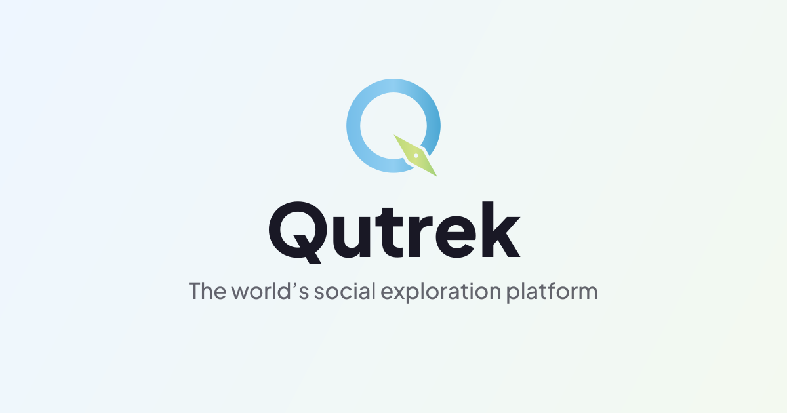</a>&nbsp;<a href="https://map.qutrek.com">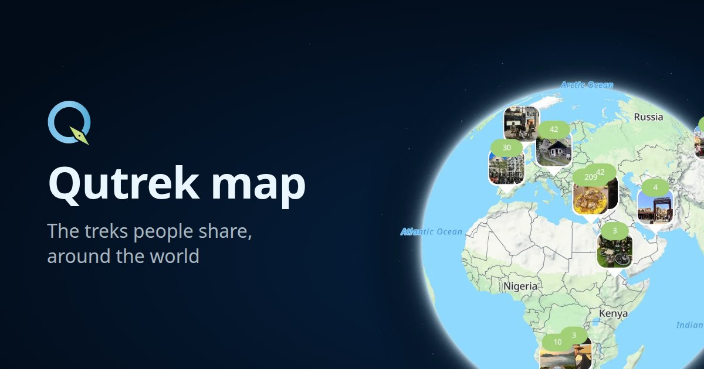</a>

**[qutrek.com](https://qutrek.com)** · **[map.qutrek.com](https://map.qutrek.com)**

 

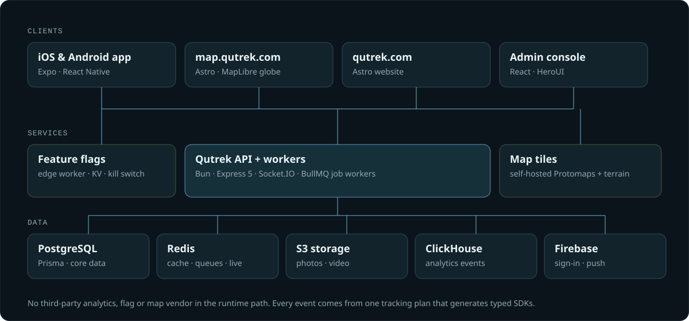

## Systems I've designed

<table>
<tr>
<td width="50%" valign="top">
<a href="https://frog.ps">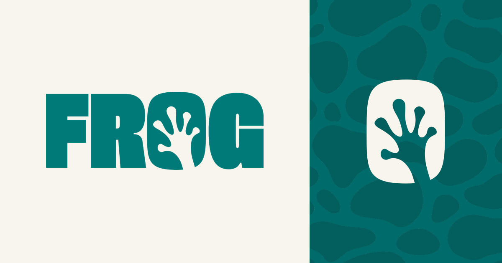</a>
<h3><a href="https://frog.ps">FROG</a></h3>

Booking platform for barbers, nail studios, spas and makeup artists in Bethlehem and Beit Sahour. Customers see the times that are actually free, book in a few taps and pay at the shop.

<b>Designed and built:</b> booking API with location search and background workers, iOS and Android app, admin portal, website.

 

</td>
<td width="50%" valign="top">
<a href="https://arc.ps">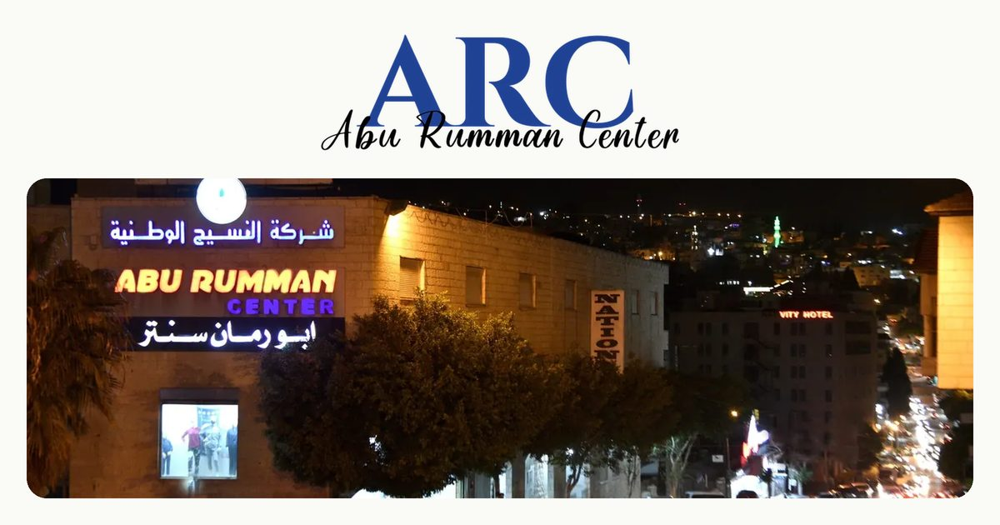</a>
<h3><a href="https://arc.ps">ARC · Abu Rumman Center</a></h3>

Online store for a family clothing shop in Beit Jala, with delivery across the West Bank, Jerusalem and the 48 areas. Arabic and English.

<b>Designed and built:</b> commerce API with job queues, storefront and admin panel.

<a href="https://arc.ps"><b>Shop at arc.ps →</b></a>

</td>
</tr>
<tr>
<td width="50%" valign="top">
<a href="https://abodayya.com">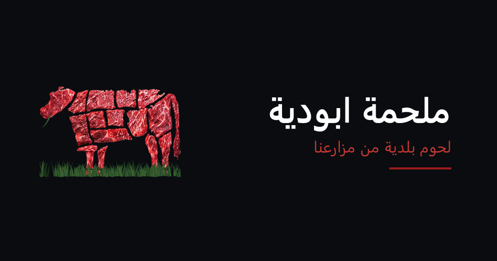</a>
<h3><a href="https://abodayya.com">Abu Dayya Butcher</a></h3>

Local meat from the family's own farms, cut fresh to order, with home delivery or pickup. Orders come in online and at the counter, and the shop keeps selling when the internet drops.

<b>Designed and built:</b> API, iOS and Android app, offline-first desktop point of sale, website.

<a href="https://abodayya.com"><b>Visit abodayya.com →</b></a>

</td>
<td width="50%" valign="top">
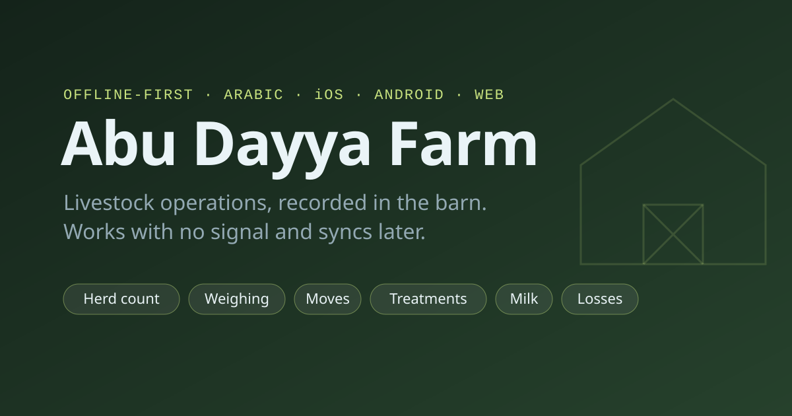
<h3>Abu Dayya Farm</h3>

Livestock operations for the family's farms. Herd counts, weighing, moves, treatments and milk are recorded in the barn with no signal, and sync when the phone is back online.

<b>Designed and built:</b> API, offline web app for the office, and an offline field app for iOS and Android built around tasks, icons and numbers.

Private system, used by the farm's own staff.

</td>
</tr>
<tr>
<td width="50%" valign="top">
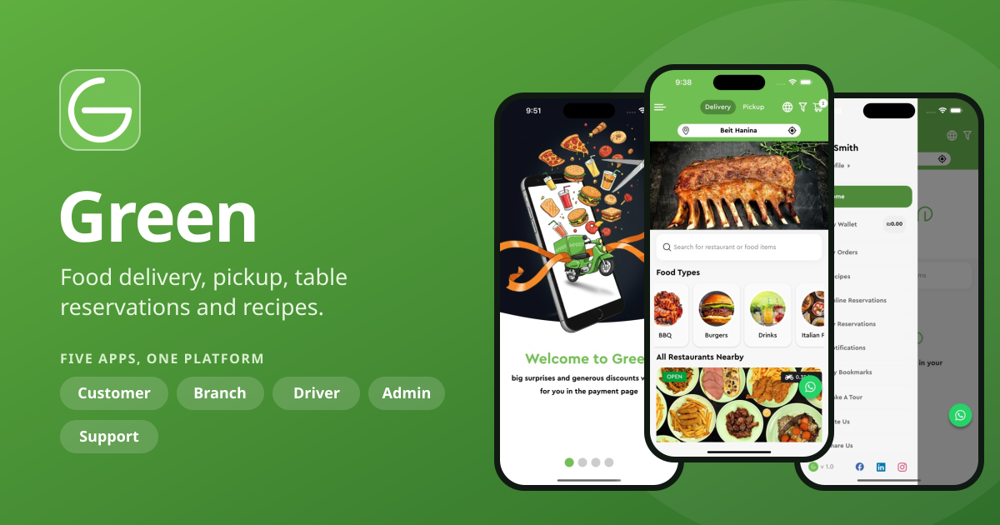
<h3>Green Delivery</h3>

Food delivery platform in Jerusalem. Customers ordered from nearby restaurants for delivery or pickup, booked tables, paid from an in-app wallet, and bought every ingredient for a recipe with one tap. The customer, driver and admin apps shipped on the App Store in 2025.

<b>Designed and built:</b> the platform API and five apps: customer, branch app for restaurants, driver, admin panel, and customer support.

</td>
<td width="50%" valign="top">
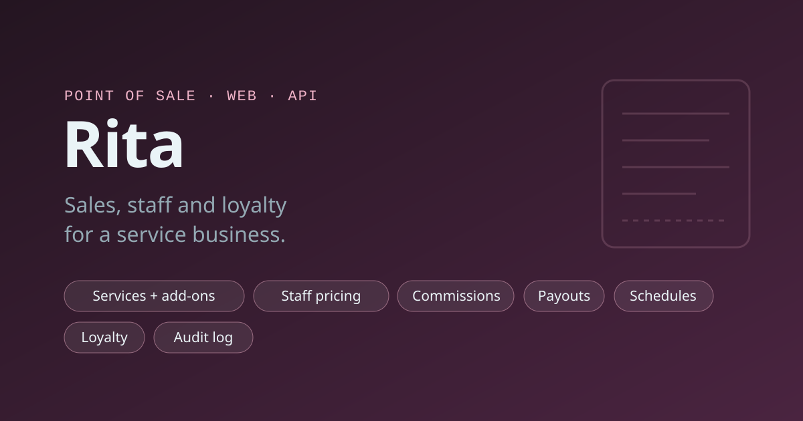
<h3>Rita</h3>

Point of sale for a service business. It handles services with variants and add-ons, prices that differ by staff member, commissions and payouts, staff schedules, and a loyalty program with rewards and birthday perks.

<b>Designed and built:</b> API with role-based permissions and a full audit log, receipts, reports, and the web app the front desk runs on.

Private system, used by the business's own staff.

</td>
</tr>
</table>

## How I design systems

The principles behind every system I architect.

- **Offline-first where it matters.** When the network can't be trusted, the local device is the source of truth: work continues with no connection and syncs safely when it returns.
- **Slow work stays off the request path.** Notifications, media processing, imports and reports run on background job queues, so APIs answer fast and scale independently of the heavy lifting.
- **Own the critical path.** Anything a product can't live without (analytics, feature flags, maps, media) is designed to be self-hosted rather than rented, so no outside vendor can take the product down.
- **Contracts before code.** Data models, events and APIs are defined once and generated into typed clients and servers, and behavior is pinned with test vectors so it can't silently drift.
- **Design for the person using it.** Interfaces are modeled around the tasks people perform, not around database tables, with clear states and as little reading as possible.
- **A written plan first.** Every system starts with an architecture document, a decision log and a clickable prototype before the first line of code.

## Native engineering

When a library isn't good enough, I go native. Qutrek's short-video feed runs on **qutrek-video**, a video engine I wrote in Swift and Kotlin and connected to React Native through C++.

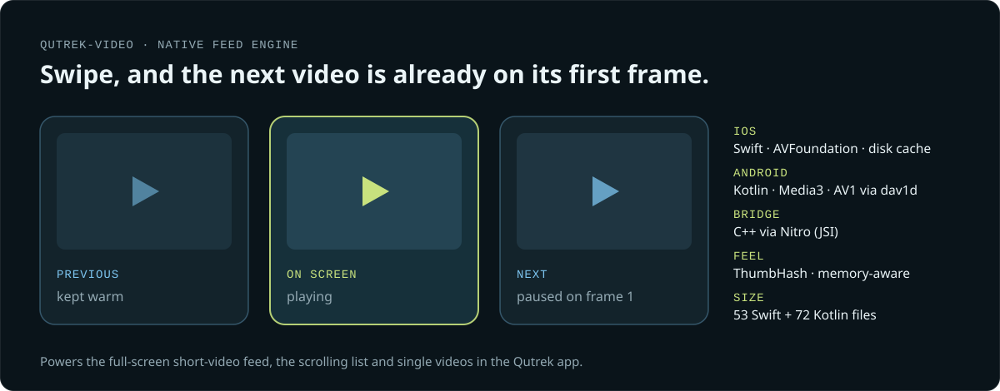

- **Instant swipes.** A pool of three players keeps the previous video warm and loads the next one off screen, paused on its first frame, so a swipe doesn't wait on the network.
- **iOS:** Swift on AVFoundation, with a byte-range disk cache so replays don't download again.
- **Android:** Kotlin on Media3, with custom buffering control and AV1 decoding through dav1d for smaller files at the same quality.
- **Built for real phones.** ThumbHash previews while a video loads, cleanup under memory pressure, and unit tests for the engine on both platforms.
- **Smaller native modules** in Kotlin for feature flags and gesture insets.

## Pipelines and automation

Releases are pipelines, not rituals. Every system ships the same way.

- **One push, every device updated.** Release pipelines verify the version is new, format and analyze the code, build, package and sign the installer, roll it out to every machine in the field, and clean up old releases.
- **Servers as code.** Nginx, systemd, PM2, PostgreSQL, Redis, backups, cron jobs, log rotation and kernel tuning live in version control next to the code they serve, so any server can be rebuilt from scratch.
- **Checks that stop bad deploys.** CI fails the build if the database schema and its migrations ever drift apart.
- **Generated, not hand-written.** Typed SDKs, server contracts and documentation are generated from a single source of truth, so clients and servers can't disagree.
- **Mobile releases on rails.** iOS and Android builds and over-the-air updates ship through Expo EAS.

## How I run engineering

Every project I take on runs on the same engineering platform: the standards, tooling and infrastructure that keep a multi-repo system shippable.

- **One engineering standard across every repo.** A single rulebook for architecture, code style and process is synced into each repository automatically, so every API, app and admin panel follows the same conventions.
- **Automated guardrails.** Workflow hooks block any change aimed at production and refuse to close out work until the type check and lint pass.
- **In-house tooling.** Scripted workflows for releases, production handovers, performance tracing and on-device testing, plus an independent verification step that re-checks every bug finding and every fix before it ships.
- **A dedicated device lab.** A Mac mini build-and-test machine for iOS that wakes over the network on demand.
- **Infrastructure I own.** Production runs on AWS, Cloudflare's edge and private servers, with supervised processes, log rotation and backups. Where it matters, analytics, feature flags and maps are self-hosted instead of rented.

## By the numbers

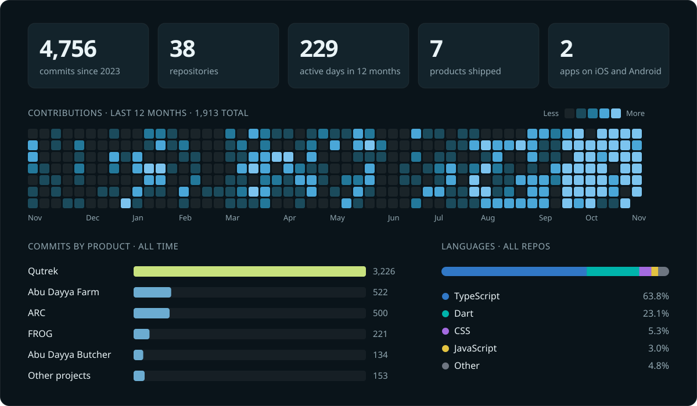

## Toolbox


## Upstream

I fix the libraries my products run on.

<!-- upstream:start -->
**Merged pull requests**

| Project | Change |
|---|---|
| [**Expo**](https://github.com/expo/expo/pull/45096) · ⭐ 53.4k | Run the notifications foreground handler on the main thread, fixing an iOS 16 crash |
| [**Expo**](https://github.com/expo/expo/pull/51955) · ⭐ 53.4k | Keep tab content mounted when `hidden` changes on Android (expo-router native tabs) |
| [**React Native Keyboard Controller**](https://github.com/kirillzyusko/react-native-keyboard-controller/pull/1695) · ⭐ 3.8k | Reset the keyboard offset once the keyboard fully closes in `KeyboardChatScrollView` |

**Crashes I tracked down that maintainers fixed**

| Project | Bug |
|---|---|
| [**Expo**](https://github.com/expo/expo/issues/44032) · ⭐ 53.4k | iOS crash in `ModuleRegistry.post(event:)` from unsynchronized dictionary access |
| [**Expo**](https://github.com/expo/expo/issues/46106) · ⭐ 53.4k | `JavaScriptPromise.init` force-try traps the app on iOS (expo-modules-jsi) |
| [**HeroUI**](https://github.com/heroui-inc/heroui/issues/6445) · ⭐ 31.1k | Table corners and pagination arrows render wrong in right-to-left layouts |
| [**VisionCamera**](https://github.com/margelo/react-native-vision-camera/issues/3916) · ⭐ 9.7k | iOS 26 crash in `capturePhoto` |
| [**VisionCamera**](https://github.com/margelo/react-native-vision-camera/issues/3773) · ⭐ 9.7k | Race-condition crash in `HybridCameraSession.start()` |
| [**React Native Video**](https://github.com/TheWidlarzGroup/react-native-video/issues/4844) · ⭐ 7.7k | iOS crash: `AVPlayer.replaceCurrentItem` called from background threads |
| [**Unistyles**](https://github.com/jpudysz/react-native-unistyles/issues/1169) · ⭐ 3k | Generated header name collides with other Nitro modules and breaks iOS builds |
| [**Unistyles**](https://github.com/jpudysz/react-native-unistyles/issues/1179) · ⭐ 3k | Reproducible heap corruption in `ShadowTreeManager::updateShadowTree` on iOS |
<!-- upstream:end -->

## Contact

**Email:** [alatrashamir3772@gmail.com](mailto:alatrashamir3772@gmail.com)
